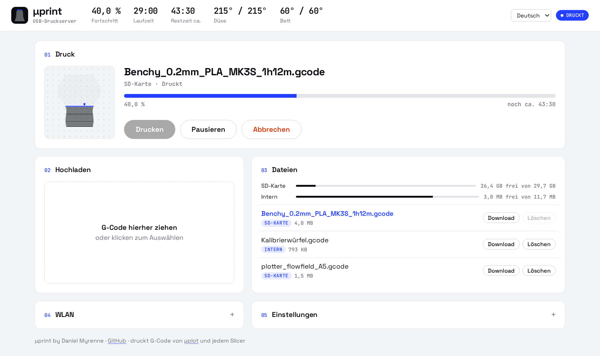

# μprint

μprint turns an ESP32-S3 into a small print server for your 3D printer or pen plotter. You upload G-code in the
browser, μprint stores it on a microSD card or in its internal flash and streams it to the machine over USB. Start,
pause and cancel from the browser on your computer or phone. No PC needs to keep running. μprint works with 3D
printers running Marlin or Prusa firmware over USB (for example the Prusa MK3S) and with AxiDraw / NextDraw pen
plotters (EiBotBoard).

## Features

- **Web interface** in English and German, for desktop and phone, no app needed
- **Storage** on microSD and, depending on the board, internal flash (up to about 12 MB)
- **Print control:** start, pause (nozzle lifted), resume, cancel (heaters off, lift, park), progress and time left
- **Slicer upload** via PrusaLink and OctoPrint compatible APIs, found automatically on the network (mDNS)
- **Pen plotter mode** for AxiDraw / NextDraw with G-code from [µplot](https://github.com/dmyrenne/uplot)
- **Status LEDs** (SK6812, WS2812, WS2811, RGB or RGBW) with a progress bar and an identification pattern for print farms
- **Wi-Fi setup** through the device's own access point with a captive portal, or run it access point only
- **Updates over the air** from the web interface, plus a [web flasher](https://dmyrenne.github.io/uprint/) for the first install
- **Safe while printing:** Wi-Fi and settings are locked during a print; if the printer is plugged in but doesn't
  answer, μprint says so and keeps retrying

## What you need

- An **ESP32-S3 board** with at least 4 MB flash.
- A **USB OTG adapter** from the board's USB port to USB-A, so you can plug in the printer cable.
- A **5 V power supply** for the board.
- A **microSD module** with a FAT32 formatted card for your files (optional on boards with internal storage).

There are three firmware variants:

| Variant | Board | Storage |
| --- | --- | --- |
| **Basic** | any ESP32-S3 with at least 4 MB flash | microSD |
| **N16R8** | ESP32-S3 with 16 MB flash and 8 MB PSRAM | microSD and about 12 MB internal |
| **XIAO** | Seeed Studio XIAO ESP32S3 (Sense) | microSD slot on the Sense camera board and about 4 MB internal |

The XIAO variant is still experimental: whether every printer is detected on the XIAO's single USB-C port hasn't
been verified on real hardware yet. Power the XIAO through its 5 V pin and keep the antenna (U.FL) connected,
otherwise Wi-Fi is very weak.

By default the SD module goes to these pins; you can choose others later under **Hardware**:

| SD module | MOSI | MISO | SCLK | CS |
| --- | --- | --- | --- | --- |
| ESP32-S3 (Basic, N16R8) | GPIO11 | GPIO13 | GPIO12 | GPIO10 |
| XIAO ESP32S3 Sense (slot) | D10 | D9 | D8 | slot |

On the XIAO you pick the pins as they are labelled on the board. An external SD module works best on D8 (SCLK),
D9 (MISO) and D10 (MOSI), with CS on any free pin such as D7. Leave D6 free, μprint writes its log there. If you
don't use a microSD card, switch it off under **Hardware**, which frees its pins.

Most boards have two USB ports. Use the one labelled `UART` or `COM` to flash the firmware; the printer later goes
on the other one (usually `USB` or `OTG`). That port has to supply 5 V for the printer to be detected. On many boards
you have to close a small solder jumper for this, often labelled `USB-OTG`.

## Flashing the firmware

The easiest way is the web flasher, right in the browser, without installing anything:

1. Open [dmyrenne.github.io/uprint](https://dmyrenne.github.io/uprint/) in **Chrome or Edge** on a computer.
   Firefox and Safari don't support the WebSerial API it needs.
2. Connect the board with a USB data cable to its `UART` or `COM` port.
3. Choose your board (**Basic**, **N16R8** or **XIAO ESP32S3**), click **Install**, pick the board's serial port in
   the dialog and confirm erasing the device the first time. After about a minute the firmware is on the board.

If the browser doesn't find the board, hold `BOOT`, press `RESET` briefly and release `BOOT`; then the connection
works. Press `RESET` once after flashing. The XIAO has only one USB-C port: hold `BOOT` while plugging in the cable,
and after flashing release `BOOT` and press `RESET`, otherwise it stays in the bootloader.

## Setup

After starting, μprint opens its own Wi-Fi called **uprint** (password `uprint123`). Connect to it; your phone or
laptop should open the setup page by itself, otherwise go to http://192.168.4.1. Under **Wi-Fi** pick your home
network and enter its password. The page then shows the new address, and from then on you reach μprint at
http://uprint.local. If you'd rather not join a network, choose **Continue without Wi-Fi**: the access point then
stays on permanently.

Now plug the printer into the board via USB. As soon as it is connected, the status at the top right turns blue.
Upload a file, click it in the list, press **Print**, done. If the printer is plugged in but doesn't answer
(switched off, wrong baud rate), μprint shows *Printer not responding* after 30 seconds, keeps retrying in the
background, and offers a **Reconnect** button.

The settings are split into two cards:

- **Settings:** device name (handy if you have several), device type (3D printer or AxiDraw), baud rate, how far the
  nozzle is lifted when pausing and cancelling and where the head parks, the slicer API key, hostname and access
  point password, firmware update, and reset.
- **Hardware:** what is wired to the ESP32-S3: microSD (on/off, pins) and status LEDs.

While a print is running, Wi-Fi, settings and hardware can be viewed but not changed.

## Printing from your slicer

μprint speaks the PrusaLink and OctoPrint APIs, so your slicer can send G-code straight to the printer. In
**PrusaSlicer**, add a physical printer: host type **PrusaLink**, hostname `uprint.local` and as API key the value
from μprint under **Settings → Slicer**. PrusaSlicer also finds μprint on the network via "Browse". **OrcaSlicer**
and other slicers use the host type **OctoPrint** with the same details. When uploading you can choose whether the
print starts right away.

μprint can't print binary G-code (`.bgcode`). If your printer profile uses it, turn it off in the slicer's printer
settings.

## Pen plotter (AxiDraw / NextDraw)

Set **Settings → Device type** to **AxiDraw / NextDraw**. μprint then translates G-code into EiBotBoard commands
itself, with motion planning (acceleration, cornering) on the ESP32-S3. The files come from
[µplot](https://github.com/dmyrenne/uplot) in AxiDraw mode (SVG → µplot → µprint → AxiDraw): their first line is
`; uplot-axidraw 1`, other files are rejected in plotter mode. Speeds, acceleration, pen servo type and pen heights
are set under **Settings**.

The **PRG** button on the plotter pauses and resumes, for example to change pens. Cancelling lifts the pen and
returns to the origin. A built-in **AxiDraw test** checks the connection, firmware, pen and button and produces a
log you can download. EiBotBoard firmware 2.x is tested; firmware 3.x (as on the NextDraw) is supported as beta.
Details are in [docs/axidraw.md](docs/axidraw.md) (German).

## Status LEDs

Optionally, a strip of addressable LEDs (SK6812, WS2812 or WS2811, also RGBW) shows what μprint is doing. The data
line goes to a free GPIO **through a 330–470 Ω resistor close to the pin**, plus 5 V and GND. Without that
resistor, the ringing data line can disturb Wi-Fi: on the XIAO ESP32S3 it dropped out completely until a 330 Ω
resistor was added. Pin, number of LEDs, LED type, colour order, brightness and a current limit are set under
**Hardware → Status LEDs** and apply immediately.

Out of the box, overall brightness is 20 % and the current limit 500 mA. Like WLED, μprint estimates the current
(about 55 mA per LED at full white) and dims the whole strip before it would exceed the limit; keep the limit below
what your 5 V supply can deliver, and feed longer strips directly from the supply. After saving, a rainbow runs
across all LEDs once. If red shows up as green, the colour order is wrong (SK6812 and WS2812 are usually GRB).

By default it looks like this. If several states apply at once, the upper one wins:

| State | Display |
| --- | --- |
| Find device (button under Hardware) | flashes white for 10 s |
| Firmware update | purple bar with the progress |
| Error | red, breathing |
| Heating | orange bar: current / target temperature |
| Printing or plotting | blue bar with the progress, the leading edge breathes |
| Paused | amber bar, pulsing |
| Finished | green until the next print starts |
| Access point open | purple, breathing |
| Wi-Fi or printer connecting | cyan chase |
| No printer | first LED dim amber |
| Ready | first LED dim green |

Under **Customize states** you choose effect, colour and brightness for every state, with a live preview on the
strip, and **Reset all to default** brings back the table above. For print farms there is also an identification
pattern: paint every LED individually (pick a brush, click or drag across the LEDs). Out of the box all LEDs show a
colour derived from the device's MAC address. If you like, the strip shows the pattern briefly every 10, 30 or 60
seconds. The colour of the first LED appears as a dot next to the device name in the web interface.

## Reset and storage

- **Reset settings** (under **Settings**) puts all settings back to factory state, including the LED appearance;
  Wi-Fi and API key are kept, so μprint stays reachable.
- **Reset everything** also forgets the Wi-Fi and creates a new API key; μprint then starts its access point for setup
  again. Without the web interface, hold the `BOOT` button for 10 seconds while μprint is running (this works as long
  as GPIO 0 isn't used as an SD or LED pin).
- Files are kept in both cases. To remove them, use **Clear …** next to a storage in the file list: it deletes all
  G-code files on that storage, or formats it completely if you tick the option (also helps with a broken file
  system). It's locked while that storage is being printed from or uploaded to.

## Updating

New versions appear under [Releases](https://github.com/dmyrenne/uprint/releases). Updating needs no cable: download
the `uprint-…-ota.bin` file for your variant (`basic`, `n16r8` or `xiao` in the name) and install it in μprint under
**Settings → Firmware**, which also shows the installed variant. μprint restarts afterwards; your settings, Wi-Fi and
all files are kept. You can also simply use the web flasher again, but without erasing the device.

The web flasher also lets you pick an older version if you want to go back. Pre-releases for testing new features
appear as *pre-release* and are listed there under **Alpha**. For normal use, choose **Release**.

## Building it yourself

To compile the firmware yourself you need [ESP-IDF](https://docs.espressif.com/projects/esp-idf/en/latest/esp32s3/get-started/)
v6.1. The build fetches the other dependencies automatically:

    git clone https://github.com/dmyrenne/uprint.git
    cd uprint
    idf.py -DUPRINT_VARIANT=basic -B build-basic build          # or n16r8, xiao
    idf.py -DUPRINT_VARIANT=basic -B build-basic -p <port> flash

`build-basic/uprint.bin` can then also be installed via **Settings → Firmware**. Releases are built automatically by
GitHub Actions: every push to a branch that changes the firmware becomes a pre-release `v1.2.3-alpha.N`, selectable
in the web flasher under **Alpha**. When the pull request is merged into `main`, it becomes the release `v1.2.3` and
the branch's alphas are removed. By default the patch number goes up; with the label `minor` or `major` on the pull
request, the corresponding part does. The web flasher shows the last 5 releases.

## How it was made

μprint was developed together with [Claude](https://claude.com/claude-code) (Anthropic).

## License

μprint is released under the [MIT License](LICENSE).
